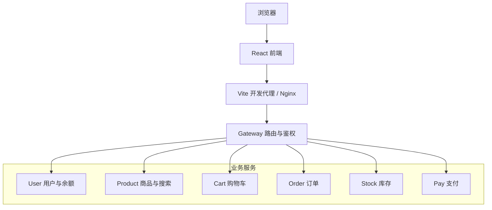

# CloudMall · 云购微商城

CloudMall 是一个基于 **Spring Cloud + React** 的全栈微服务商城，面向微服务学习、工程实践与代码复盘。

项目以「商品浏览 → 购物车 → 订单 → 库存 → 余额支付」为主线，将服务发现、网关鉴权、消息解耦、幂等处理、库存补偿和支付结果恢复落到具体业务中。除了正常下单流程，也关注请求重复、消息重投、依赖暂时不可用，以及“请求已经受理，但结果尚未确认”时系统如何继续处理。

后端采用 **7 个可独立启动的服务 + 1 个公共模块**，前端使用 React、TypeScript 和 Vite，中间件通过 Docker Compose 部署。默认购物流程使用本地模拟余额支付，适合在 IDEA 中逐个启动服务、观察调用与数据变化。

> 当前 GitHub 版本保留业务源码、数据库脚本和部署配置。历史测试、压测脚本、内部设计文档与实验数据未随源码发布。项目定位为学习型实战，不承诺生产级高可用或容量指标。

## 导航

- [业务功能](#业务功能)
- [系统架构](#系统架构)
- [技术栈](#技术栈)
- [值得关注的实现](#值得关注的实现)
- [目录结构](#目录结构)
- [本地运行](#本地运行)
- [接口与数据约定](#接口与数据约定)
- [验证范围与默认配置](#验证范围与默认配置)
- [常见问题](#常见问题)

## 业务功能

| 模块 | 主要能力 |
| --- | --- |
| 用户与账户 | 注册、登录、退出、个人资料、收货地址、角色区分与账户余额 |
| 商品与分类 | 分类浏览、商品列表、SKU 规格、商品详情、参数展示、关键词查询与排序 |
| 商品管理 | 管理员维护分类、商品、SKU 和参数，执行商品上架与下架 |
| 购物车 | 添加商品、调整数量、勾选、删除，以及结算前重新校验商品和价格 |
| 订单 | 创建订单、保存商品与地址快照、查询列表与详情、待支付取消、超时处理与收货确认 |
| 库存 | 预留、确认售出、回滚释放，维护库存流水、缓存投影与一致性核对 |
| 支付 | 创建支付单、模拟余额支付、扣款/退款账本、幂等处理与未决结果恢复 |
| 秒杀 | 活动查询、用户限购、Redis 预扣、异步下单及 Sentinel 限流保护 |

前端提供首页、商品列表与详情、购物车、结算、支付结果、订单、个人中心、地址管理和商品管理页面。

**建议先体验普通购物流程：** 注册账号并添加地址，选择商品加入购物车，确认订单后使用余额支付，最后检查订单状态、账户余额与库存变化。秒杀、在线指标和 TCC 等能力可在理解基础链路后分别研究。

## 系统架构

前端的 `/api` 请求统一进入 Gateway。业务服务通过 Nacos 注册发现，跨服务同步调用使用 OpenFeign，异步任务通过 RabbitMQ 传递。



| 服务 | 职责边界 | 本地端口 |
| --- | --- | ---: |
| [cloud-mall-gateway](backend/cloud-mall-gateway) | 统一入口、路由、登录态鉴权、跨域与限流预处理 | 8080 |
| [cloud-mall-user](backend/cloud-mall-user) | 用户、地址、余额扣减/退款及资金操作记录 | 8081 |
| [cloud-mall-product](backend/cloud-mall-product) | 商品、分类、SKU、搜索与商品索引同步 | 8082 |
| [cloud-mall-cart](backend/cloud-mall-cart) | Redis 购物车、商品快照刷新与结算预览 | 8083 |
| [cloud-mall-order](backend/cloud-mall-order) | 订单创建、状态流转、月度分表及库存操作协调 | 8084 |
| [cloud-mall-stock](backend/cloud-mall-stock) | 库存事实、预留/确认/回滚、缓存修复与秒杀配额 | 8085 |
| [cloud-mall-pay](backend/cloud-mall-pay) | 支付创建、结果处理、资金与订单同步、恢复任务 | 8086 |
| [cloud-mall-common](backend/cloud-mall-common) | 公共响应、异常、身份上下文与通用消息类型；不独立启动 | — |

普通购物中，Cart 向 Product 刷新商品信息；Order 查询用户地址和商品快照、调用 Stock 预留库存，并在本地事务提交后清理符合条件的购物车项；Pay 协调 User 扣款和 Order 支付状态，再根据库存操作结果确认最终支付状态。

## 技术栈

| 分类 | 技术与版本 | 在项目中的用途 |
| --- | --- | --- |
| 后端基础 | Java 17、Spring Boot 2.7.18、Maven 多模块 | 服务运行、依赖管理与构建 |
| 微服务 | Spring Cloud 2021.0.5、Spring Cloud Alibaba 2021.0.5.0 | Gateway、OpenFeign 与分布式组件集成 |
| 注册与配置 | Nacos 2.2.0 | 服务发现、Sentinel 规则订阅与刷新 |
| 数据持久化 | MySQL 8.0、MyBatis-Plus 3.5.5 | 业务数据、事务、条件更新与持久化台账 |
| 缓存 | Redis 7.0 | 登录态、购物车、库存投影与秒杀控制 |
| 消息 | RabbitMQ 3.11-management | 商品索引同步、订单超时与异步下单 |
| 搜索 | Elasticsearch / Kibana 7.17.0 | 商品关键词检索、索引查看 |
| 流控与事务实践 | Sentinel 1.8.6、Seata 1.5.2 | 限流/熔断，以及独立开关控制的 AT/TCC 实践 |
| 订单分表 | Sharding-JDBC 4.1.1 | 可选月度分片模式；默认采用现有动态月表路由 |
| 前端 | React、TypeScript、Vite、React Router | 商城交互与路由，具体版本由 `package-lock.json` 锁定 |
| 部署与观测 | Docker Compose、Nginx、Actuator、Prometheus 2.47.0、Grafana 9.5.5 | 本地基础设施、静态资源代理、健康检查和指标采集 |

Compose 还提供 Zipkin 2.23.19 实例作为链路观测基础设施；启动该容器本身不代表所有服务已完成调用链上报。依赖版本以 [pom.xml](pom.xml)、[前端锁文件](frontend/package-lock.json)和 [Compose 配置](docker-compose.yml)为准。

## 值得关注的实现

### 1. 按业务职责拆分服务内部结构

Controller 处理请求绑定、校验与服务委托；Service 承载业务规则和事务编排；Mapper 集中数据库访问与自定义 SQL。请求 DTO、响应 VO 和持久化 PO 分开放置，复杂服务再按查询、库存协调、恢复、索引等职责组织实现。

这使“订单创建”“订单查询”“支付成功处理”等用例可以分别阅读和维护，而不必从一个大型 Controller 中寻找全部逻辑。

### 2. 订单与库存通过持久化记录协调

下单时重新读取价格、商品状态和地址，服务端计算金额并保存快照。库存预留、订单落库和后续确认/回滚都有对应记录，失败时按原订单身份恢复，避免把一次超时直接解释为“库存操作没有发生”。

普通库存以 MySQL 事实为准，Redis 用作带版本的数量投影。缓存异常或投影差异由修复任务处理，库存读取也保留回退路径。

### 3. 消息发布与消费都有状态记录

商品变更先在本地事务中写入 outbox（待发送事件表），再由任务投递到 RabbitMQ。消费端记录处理状态，并按商品版本更新 Elasticsearch，以处理重复投递、旧消息和失败重试。

订单超时使用 RabbitMQ 的 TTL + 死信交换机机制；秒杀订单采用异步消息处理。消息发送成功、消息被消费和业务完成是不同状态，代码分别处理这些阶段。

### 4. 支付保留“结果待确认”语义

默认余额支付使用 `LEGACY` 协议。扣款、订单状态更新和库存确认可能先后完成，接口可以用 HTTP `202` 表达尚未确认的结果，由原恢复任务继续核对。

前端收到 `202` 后进入结果页，只读查询原订单的支付状态，不自动重复提交扣款；查询有次数上限，终态与页面卸载会停止后续调度。资金侧通过操作键与账本记录约束重复扣款和退款。

### 5. 高级能力通过明确开关启用

项目包含 TCC 资金资源、Fence、支付编排/恢复、商品在线指标及索引重建等实现。它们涉及多服务配置和数据结构前置，默认不会随普通购物演示全部启用。可结合相关模块的 `config`、`service/impl` 与数据库迁移脚本阅读。

## 目录结构

```text
Cloud-Mall/
├── backend/
│   ├── cloud-mall-common/       公共类型与基础能力
│   ├── cloud-mall-gateway/      网关
│   ├── cloud-mall-user/         用户、地址与资金
│   ├── cloud-mall-product/      商品、检索与索引
│   ├── cloud-mall-cart/         购物车
│   ├── cloud-mall-order/        订单与恢复任务
│   ├── cloud-mall-stock/        库存与秒杀
│   ├── cloud-mall-pay/          模拟支付与状态恢复
│   └── database/               初始化 SQL、迁移和数据导入脚本
├── frontend/
│   ├── src/                    页面、组件与 API 封装
│   ├── package.json
│   └── vite.config.ts          5173 端口与 /api 开发代理
├── deploy/
│   ├── nacos/                  健康检查与 Sentinel 规则发布
│   ├── elasticsearch/          搜索索引辅助脚本
│   ├── nginx/                  静态资源与 API 代理
│   └── prometheus/             指标采集配置
├── .env.example                本地环境配置示例
├── docker-compose.yml          中间件与 Nginx
└── pom.xml                     Maven 聚合工程
```

## 本地运行

### 1. 准备环境

| 工具 | 要求 |
| --- | --- |
| JDK | 17 |
| Maven | 3.9+ |
| Node.js | 22.12+，使用 npm 安装前端依赖 |
| Docker | Docker Engine / Docker Desktop，包含 Compose v2 |
| IDEA | 可直接导入根目录 `pom.xml`，项目 SDK 设置为 JDK 17 |
| PowerShell | 使用仓库中的 `.ps1` 辅助脚本时准备 PowerShell 7 |

```bash
git clone https://github.com/opaoxx/Cloud-Mall.git
cd Cloud-Mall
```

业务服务运行在宿主机，中间件运行在 Docker 中。请预留七个 Java 服务和多种中间件共同运行所需的内存，并检查下表端口没有被占用。

### 2. 构建源码

在仓库根目录打包后端：

```bash
mvn -Dmaven.test.skip=true package
```

`maven.test.skip=true` 同时跳过测试源码编译和执行，适用于当前 GitHub 源码版本，也避免本地留存但未发布的历史测试参与构建。普通构建成功不等于完整业务测试已执行。

安装前端锁定依赖、执行类型检查并生成静态资源：

```bash
cd frontend
npm ci
npm run lint
npm run build
cd ..
```

先生成 `frontend/dist`，再启动 Compose 中的 Nginx，静态站点才能正常提供首页。当前 `lint` 脚本执行 TypeScript 类型检查。

### 3. 启动中间件

```bash
docker compose up -d
docker compose ps -a
```

首次使用新 MySQL 数据卷时，[schema.sql](backend/database/schema.sql)会创建五个业务数据库、表结构和演示商品。已有数据卷不会因为再次启动而重新执行初始化 SQL；升级脚本位于 [backend/database](backend/database)，应按具体功能和现有表结构选择。

Nacos 的 `nacos-bootstrap` 是一次性账号初始化服务，成功后显示 `Exited (0)` 属于正常状态。业务服务启动前，应确认 MySQL、Redis、RabbitMQ、Nacos、Elasticsearch 等依赖已经就绪。

| 组件 | 宿主机端口 / 访问入口 |
| --- | --- |
| MySQL | `13307` |
| Redis | `16379` |
| RabbitMQ | AMQP `15673`；管理界面 [localhost:15674](http://localhost:15674) |
| Nacos | 控制台 [localhost:18848/nacos](http://localhost:18848/nacos)；客户端 gRPC `19848`，服务端 gRPC `19849` |
| Seata | TC `18091` |
| Elasticsearch | [localhost:9200](http://localhost:9200) |
| Kibana | [localhost:15675](http://localhost:15675) |
| Sentinel Dashboard | [localhost:18858](http://localhost:18858) |
| Prometheus | [localhost:9090](http://localhost:9090) |
| Grafana | [localhost:3000](http://localhost:3000) |
| Zipkin | [localhost:19411](http://localhost:19411) |
| Nginx 商城入口 | [localhost:18088](http://localhost:18088) |

本地 MySQL、RabbitMQ、Nacos、Grafana 和已启用登录的 Sentinel 控制台使用 `root/root`；Redis 密码为 `root`，Elasticsearch 开发配置关闭认证。商城用户账号与这些中间件账号分开，以上配置仅面向本地练习。

需要将仓库中的默认 Sentinel 规则发布到 Nacos 时，执行：

```powershell
pwsh -File deploy/nacos/publish-sentinel-rules.ps1
```

脚本默认保留 Nacos 中已经存在的同名规则；是否覆盖应结合当前实验配置决定。

### 4. 启动七个业务服务

推荐按 **User / Product / Stock / Cart → Order / Pay → Gateway** 的顺序启动。可在 IDEA 中运行各模块根包下的 `UserApplication`、`ProductApplication` 等启动类，或分别打开终端运行打包后的 JAR。

IDEA 的 VM options 可使用：

```text
--add-opens=java.base/java.lang=ALL-UNNAMED -Duser.timezone=Asia/Shanghai -Dfile.encoding=UTF-8
```

以 User 服务为例，命令行启动方式如下；其余服务替换模块名即可，Common 无需启动：

```bash
java --add-opens=java.base/java.lang=ALL-UNNAMED "-Duser.timezone=Asia/Shanghai" "-Dfile.encoding=UTF-8" -jar backend/cloud-mall-user/target/cloud-mall-user-0.1.0-SNAPSHOT.jar
```

默认端口见[服务表](#系统架构)。服务端口和中间件连接参数位于各模块的 `src/main/resources/application.yml`。启动后可检查 [User 健康端点](http://localhost:8081/actuator/health)，并在 Nacos 中确认七个服务均已注册。

### 5. 打开商城

**开发模式：**

```bash
cd frontend
npm run dev
```

访问 [localhost:5173](http://localhost:5173)，Vite 将 `/api` 代理到 `http://localhost:8080`。5173 被占用时会直接报错，不会自动换端口。API 基址可通过 [frontend/.env.example](frontend/.env.example)所示的 `VITE_API_BASE_URL` 配置。

**静态页面模式：** 访问 [localhost:18088](http://localhost:18088)。Nginx 提供 `frontend/dist`，并将 API 转发到宿主机的 Gateway。前端修改后重新执行 `npm run build` 即可更新挂载的静态资源。

首次 User 服务启动时，会在缺少管理员账号的情况下初始化 **`admin / admin123`**。普通用户通过页面自行注册，默认角色为 `USER`，初始模拟余额为 **10000.00**。

建议先以普通用户完成一笔订单，再使用管理员账号体验商品管理。新库没有预置完整秒杀活动时，首页显示活动准备中是正常现象。

## 接口与数据约定

以下是便于阅读源码和手动联调的主要公开入口。请求通过 Gateway 的 `8080` 端口发送，具体字段与校验以对应 Controller、DTO 和前端 [api.ts](frontend/src/api.ts)为准。

| 方法 | 路径 | 用途 |
| --- | --- | --- |
| POST | `/api/auth/register`、`/api/auth/login`、`/api/auth/logout` | 注册、登录与退出 |
| GET / PUT | `/api/users/me` | 查询或更新个人资料 |
| GET / POST | `/api/users/me/addresses` | 查询或新增收货地址 |
| GET | `/api/products`、`/api/products/{id}` | 商品列表与详情 |
| GET | `/api/categories` | 分类列表 |
| GET / POST | `/api/cart` / `/api/cart/items` | 查询购物车 / 加入商品 |
| POST | `/api/cart/settlement/preview` | 结算前校验与金额预览 |
| POST / GET | `/api/orders` | 创建订单 / 查询订单列表 |
| GET | `/api/orders/{orderNo}` | 查询订单详情 |
| POST | `/api/orders/{orderNo}/cancel` | 取消待支付订单 |
| POST | `/api/payments` | 创建支付单 |
| POST | `/api/payments/{payNo}/mock-success` | 触发本地模拟余额支付 |
| GET | `/api/payments/orders/{orderNo}` | 查询订单对应支付结果 |

统一响应包含 `code`、`message`、`data` 和 `requestId`，业务成功码为字符串 `"0"`。需要同时判断 HTTP 状态和业务码；尤其是支付 `202`，它表示结果待确认，并不代表最终成功。

| 约定 | 说明 |
| --- | --- |
| 登录身份 | `Authorization: Bearer <token>`；使用 Redis 不透明 Token，默认有效期 2 小时 |
| 幂等键 | 订单、支付等写入口按接口要求携带 `Idempotency-Key`；同一操作重试保留原键 |
| 金额 | Java 使用 `BigDecimal`，JSON 使用字符串，例如 `"79.80"` |
| 时间 | 业务采用 `Asia/Shanghai`，接口时间带 `+08:00`，数据库时间按该时区语义存储 |
| 分页 | 列表统一返回 `items`、`page`、`pageSize`、`total` |
| 订单快照 | 商品、价格与地址以服务端校验后保存的快照为准，不信任前端提交金额 |

## 验证范围与默认配置

发布前已完成真实浏览器、Gateway 和六个业务服务的普通购物链路验收，包括注册登录、地址、商品索引与搜索、购物车、下单、余额支付、普通待支付取消、重复请求、跨用户访问隔离和退出登录。核验同时对照了订单、支付、库存与资金账本，而非只检查页面提示。

当前默认配置与可选能力需要区分：

| 能力 | 默认状态 / 使用前提 |
| --- | --- |
| 普通购物与余额支付 | 默认使用 `LEGACY` 模拟余额支付，无需第三方支付账号 |
| 商品关键词查询 | 默认走现有 SQL 查询；`cloudmall.product.search.enabled=true` 时，带关键词的请求使用 ES |
| 商品索引同步 | outbox 分发、消费与死信重放默认启用；直接导入 SQL 的商品仍需通过变更/发布事件或相应重建流程形成索引 |
| 商品在线指标 / 索引重建 | 独立开关，默认关闭；涉及对应表结构、索引版本及配置前置 |
| 订单月表 | 默认 `dynamic-monthly`；`sharding-monthly` 是显式启用的 Sharding-JDBC 模式 |
| TCC 支付及取消链 | 保留独立开关和实现，默认关闭；需配套配置与迁移，不能只改一个支付模式值 |
| 观测 | 服务提供 Actuator 健康/指标端点，Prometheus 已配置采集目标；Grafana 可用于接入展示 |

学习 ES 检索时，可在 Product 的启动参数中设置 `--cloudmall.product.search.enabled=true`，并使用管理员的商品发布/更新操作触发索引同步。相关配置见 [Product application.yml](backend/cloud-mall-product/src/main/resources/application.yml)。

GitHub 源码版本可执行的验证为后端打包、前端类型检查与前端构建，命令见[本地运行](#本地运行)。历史单元/集成测试、隔离实验和压测材料保留在本地，当前仓库没有 `npm test` 脚本。普通购物验收通过，不代表 TCC 全故障矩阵、秒杀容量或生产性能已全部验收。

## 常见问题

<details>
<summary><strong>Compose 已启动，为什么还不能下单？</strong></summary>

Compose 负责中间件、观测组件和 Nginx，七个业务 Java 服务需要另行启动。检查依赖是否健康、Nacos 是否存在服务实例、Gateway 是否监听8080，以及前端代理是否指向正确入口。可先查看 `docker compose ps -a` 和对应服务日志。

</details>

<details>
<summary><strong>Nginx 首页打不开，或者前端修改后没有变化？</strong></summary>

确认已执行 `npm ci` 和 `npm run build`，并生成 `frontend/dist/index.html`。Nginx 使用构建产物，Vite 开发模式则直接使用源码；两者入口分别为18088和5173。修改前端后，需要重新构建才能更新 Nginx 页面。

</details>

<details>
<summary><strong>Nacos 控制台能登录，但服务注册失败？</strong></summary>

核对服务配置中的地址、用户名/密码，以及18848对应的客户端 gRPC 端口19848。当前初始化脚本创建 `root` 用户和 `cloudmall_admin` 角色；若日志出现 `authorization failed`，还需检查角色对默认 `public` 命名空间的授权，包括 `public:*:*` 的读写权限。HTTP登录可用不能替代实际注册校验。

使用新 Nacos 数据卷时可沿用 [.env.example](.env.example)中的默认 hostname；已有卷的 Raft 节点身份应保持稳定，不要通过清空数据卷解决身份不一致。

</details>

<details>
<summary><strong>商品列表有数据，开启 ES 搜索后却搜不到？</strong></summary>

初始化 SQL 写入数据库，不会自动生成每个商品的变更消息。检查商品是否已发布、outbox 是否发送、Rabbit 消费是否完成，以及 ES 索引中是否存在对应商品。搜索开关开启后，也要核对索引映射与版本；索引迁移辅助脚本位于 [deploy/elasticsearch](deploy/elasticsearch)。

</details>

<details>
<summary><strong>支付提示“结果确认中”，是否应该再次付款？</strong></summary>

保留原订单和支付单，等待结果页的只读查询，或从订单详情查看最新状态。一次请求超时或返回202，不足以判断资金操作失败；恢复任务会按原记录继续核对。排查时同时查看支付意图、余额账本和订单/库存状态，不要通过手工补扣款来消除提示。

</details>

<details>
<summary><strong>Windows 端口绑定失败，或重启后初始化 SQL 没有重新执行？</strong></summary>

端口失败时，先检查监听占用及 Windows 的 TCP 排除范围，并同步核对 Compose 与业务服务配置。初始化 SQL 只在 MySQL 新数据目录建立时运行；修改 SQL 文件后重启容器不会迁移旧库。保留已有数据，按所需迁移脚本处理，不要将删除卷作为常规重启步骤。

</details>
